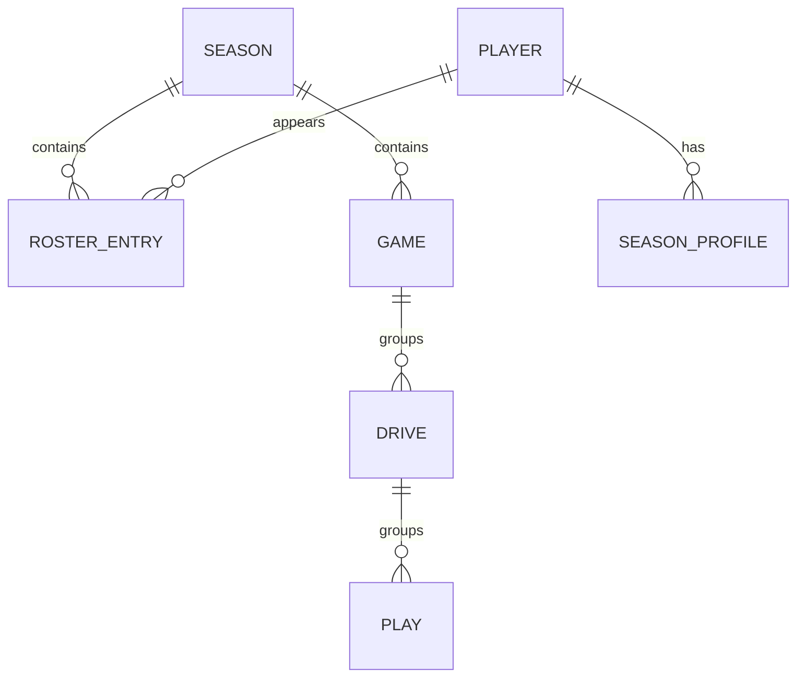

# Data model

## Current model (implementation reference)
`seasonData.ts` defines SeasonFile: season, source, retrievedAt, sourceModified, players, thirdDown, leagueRating and optional roster, depthChart, rushing, receiving, redzone, defense, teamIdentity, games, matchupTeams. See source for exact fields. `gameData.ts` defines BearsGame (id, week, home, away, date, scores, final, drives), GameDrive (id, team, result, plays, start, snapCount, netYards, epa, epaCount), GamePlay (id, quarter, clock, down, distance, start/end, yards, kind, epa, description, td, turnover). Nullable fields mean unavailable, not zero.

Conceptual relationships, not a deployed relational database. Player identity uses GSIS ID with ESPN crosswalk when available. Do not join on names alone. Artwork names are presentation references, not primary keys. Game and drive identifiers are scoped to source/season/game as needed.

## Proposed contracts (not implemented)
- PlayerSeasonProfile: playerId, season, heightInches?, weightLbs?, birthDate?, college?, experience?, sourceRefs.
- SourceRef: id, url, title, publisher, verifiedAt.
- EditorialEntry: id, subjectType, subjectId, kind, season?, validFrom?, validTo?, title, body, sourceRefs.
- TriviaQuestion: id, subjectId, prompt, options[{id,label}], correctOptionId, explanation, sourceRefs.
- LeadershipTenure: personId, teamId, role, startDate, endDate?, sourceRefs.
- MetricDefinition: id, unit, formula, denominator, exclusions, version, sourceRefs.
- CoverageMatrix: season, metricId, availability, reason.
- PreferenceStore: version, favoritePlayerIds, favoriteSeasons, recentViews, triviaProgress.

Keep generated stats, curated content and preferences independent. Validate uniqueness, foreign references, required fields, nullable fields and effective dates. Add schema versions and migrations when contracts change; avoid claiming existing JSON has a version field. No PII or account backend assumed.
