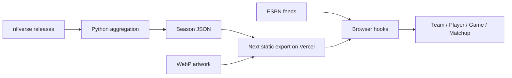

# System architecture

## Current boundaries
Bears Intelligence is a modular product in the portfolio repository. Next.js static export, React/TypeScript and CSS compose the experience. There is no dedicated Bears server or database. Keep independent product code and documentation; extraction to a separate repository is deferred.

## Paths
- `src/app/chicago-sports/bears/`: primary route; classic rollback experience, intelligence alternate route, non-indexed lab.
- `src/components/features/bears-intelligence/`: Studio composition, hero, picker, chart components, typed contracts, schedule matching and CSS.
- `src/hooks/`: shared ESPN hooks (portfolio boundary; avoid breaking other sports).
- `scripts/build-bears-analytics.py` and aggregation modules: offline ingestion.
- `public/data/bears-intelligence/{season}.json`: published generated snapshots.
- `public/images/bears-intelligence/`: curated artwork.
- `.github/workflows/refresh-bears-intelligence.yml`: refresh orchestration.

## Constraints
Static export precludes runtime Next server endpoints. Browser ESPN availability/CORS, upstream publication lag and payload size constrain delivery. Game matching uses opponent normalization, local date and home/away identity, not guessed IDs. Exact tracking is not available from current inputs.

## Proposed expansion
Separate curated editorial JSON, typed metric registry, season/coverage manifest and local preferences. Introduce database or independent deployment only after explicit requirements and ADR review. See [data model](DATA-MODEL.md).
